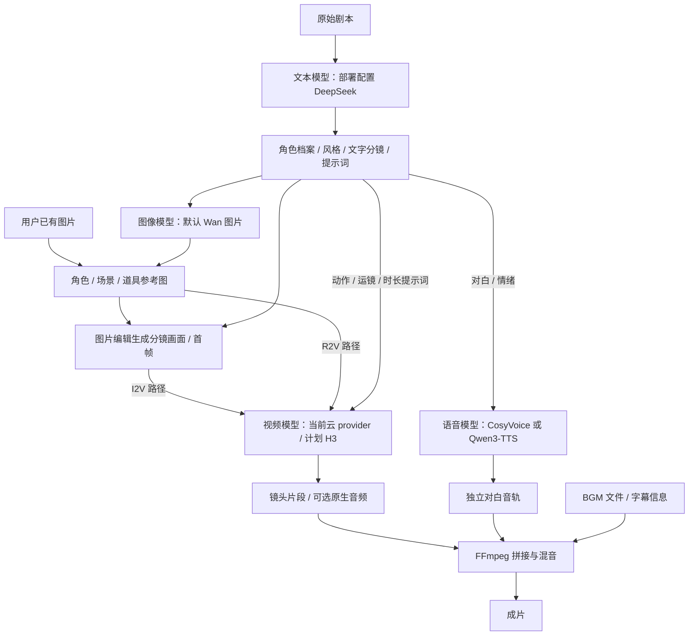
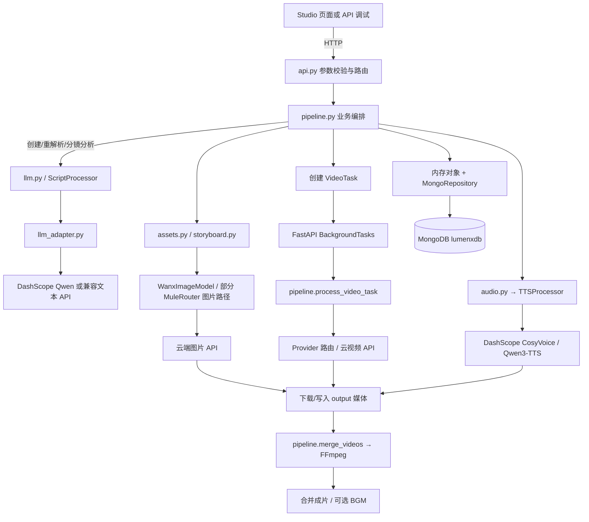
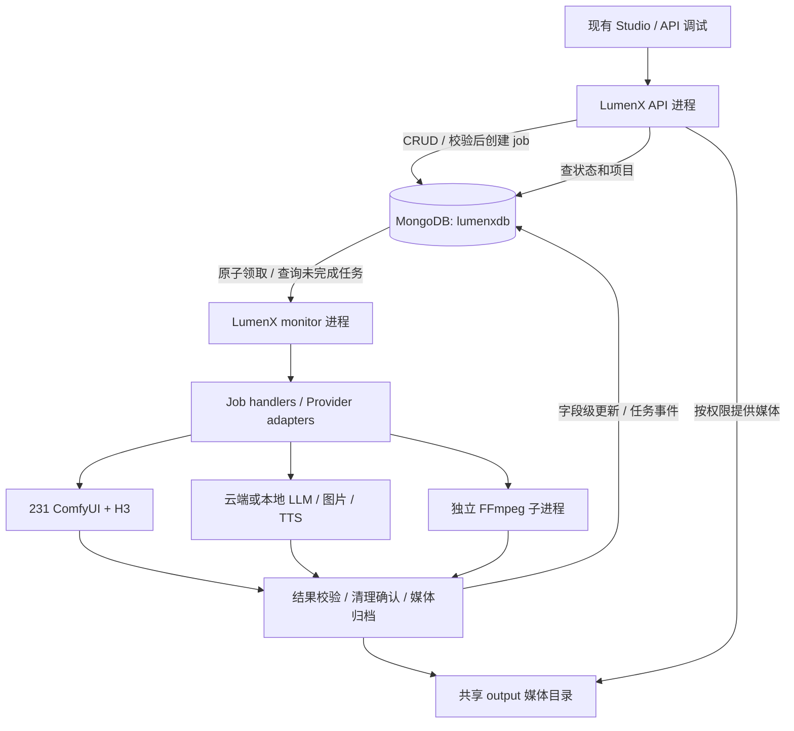

# LumenX 后端差距评估与三周实施计划

评估日期：2026-10-13；最近修订：2026-10-16。原轮次只更新方案；用户现已授权并完成首步 MongoDB 存储迁移，后续任务层仍按天实施。

**2026-10-16 实施进展：**231 已切换至 `lumenxdb`，导入 4 个项目、1 个系列、1 份共享资产库；Playground 存储也已适配。旧 JSON 已备份，原分镜/视频引用与 23 个媒体链接验证通过。当前仍单 API、仍有内存缓存，独立 monitor 和任务队列尚未实现。详见 [MongoDB 迁移与运维说明](./2026-10-16-MongoDB迁移与运维说明.md)。

适用对象：一名后端开发者，使用 Codex 编码，同时每天保留学习时间。证据来自本地 LumenX 代码（初始评估业务基线 `a80c8cc`）、ComfyOps（本轮 HEAD `017ea9a`）、领导需求和官方资料。初始评估未登录 231；10 月 16 日已完成 MongoDB 线上迁移验证，未提交 GPU 生成任务。其他未验收项仍以各节说明为准。

## 1. 本轮决定与交付边界

**采用一个 LumenX 仓库、一套版本与配置、一个 MongoDB 逻辑数据库，运行独立的 API 和 monitor 两个进程。将 task-archiver 的调度、归档、恢复代码迁入本仓库，不把它作为长期独立业务后端维护。**

这替代旧版“LumenX 通过 HTTP 长期调用另一个 task-archiver 项目”的建议。保留两种进程职责有助于稳定运行，并不等于要维护两个项目。

| 决策 | 本期安排 |
|---|---|
| API | 校验请求、鉴权、项目 CRUD、任务入库、查状态、返回媒体；不承担新生成任务的执行和轮询 |
| monitor | 从 MongoDB 领取任务，调用模型服务，跟踪执行、清理、下载、回写、重试与恢复 |
| MongoDB | 同一 `lumenxdb` 数据库分集合保存项目、资产、任务、节点、事件；媒体放磁盘 |
| H3 | 复用现有 231 ComfyUI、模型和 API 工作流，不顺便迁到 vLLM-Omni |
| 项目持久化 | 为 API/monitor 跨进程协作优先做 Repository 和 MongoDB；不能让两者各自持有整份 JSON 后互相覆盖 |
| 旧云模型路径 | 分阶段迁移至 job handler；没有迁出的入口必须清单标记，不能宣称全部完成分离 |
| ManjuForge | 值得做“剧本/分镜质量建议助手”限时 POC，不作为生成引擎或调度核心 |
| Deep Agents | 作为每天学习的小实验，先读项目快照、给建议；不控制 GPU 调度，不占用主线交付关键路径 |
| Nautilus | 本期不整套引入；理由是集成适配与交付成本，不以 Star 少推断代码差 |

**三周推荐交付：**3～5 个镜头的 H3 后端生成闭环、MongoDB 任务和项目存储、API/monitor 分离、可查询/取消/恢复、基础视频合成、部署与验证材料。

**两周保底交付：**上述链路的受控技术演示；权限、报表、旧云生成全面迁移、完整离线可能未完成。若领导要求所有旧任务也完成异步化，需要增加时间或减少其他功能。

不在三周内承诺：LoRA 训练、92% 自动角色识别、专业自动精剪、多机位/画中画、OpenCue 集群、30/60 路同时 GPU 推理及固定秒数 SLA。全链路离线也需额外部署 LLM、图片和 TTS 等服务，不能仅凭 H3 已部署认定完成。

## 2. 当前到底调用了哪些模型

以下是**代码默认值和已实现路径**，不是对 231 当前环境变量、用户设置或单个项目实际模型的实时确认。旧项目可保留历史模型，请求也可显式覆盖。

**部署配置补充（2026-10-14）：**本地 `.env.231` 第 6～9 行配置 `LLM_PROVIDER=openai`、`OPENAI_BASE_URL=https://api.deepseek.com/v1`、`OPENAI_MODEL=deepseek-chat`，密钥已配置但不在文档展示。因此，部署采用这份配置时，经 `LLMAdapter` 且未显式覆盖模型的文本任务使用 DeepSeek。下表的 DashScope Qwen 链是代码后备默认，不能直接当作你的部署选择。API 启动读取项目根目录 `.env`，需要确认服务器已将这份配置应用到实际 `.env`；本轮未远程验证。

| 能力 | 当前模型/调用方式 | 用途及代码证据 |
|---|---|---|
| 剧本解析、实体/分镜抽取、提示词润色 | 默认 DashScope：`qwen3.7-plus → qwen3.6-plus → qwen-plus`；仅模型不可用类错误触发回退 | `src/apps/comic_gen/llm.py`、`llm_adapter.py`；使用 OpenAI 兼容 Chat Completions API。此前 AGENTS 描述的 3.6 默认已落后于本地代码 |
| 可替换文本 LLM | `LLM_PROVIDER=openai` 时用 `OPENAI_BASE_URL/OPENAI_MODEL/OPENAI_API_KEY`；未设模型时代码默认 `gpt-4o` | 这里的 `openai` 是兼容接口分支名，可对接内网服务，不意味着必须调用 OpenAI 云端 |
| 图片生成/编辑 | catalog 的 `t2i_model/i2i_model/image_model` 默认均为 `wan2.7-image-pro` | `config/model_catalog/catalog.meta.yaml`；角色/场景/道具图及分镜图主要经 `WanxImageModel` 调 DashScope |
| 图片其他选择 | catalog 有 `qwen-image-2.0`、`qwen-image-2.0-pro`；资产生成器有 `gpt-image-2` 的 MuleRouter 路径 | `config/model_catalog/families/`、`assets.py`、`src/models/mulerouter.py`。`storyboard.py` 仍直接使用 WanxImageModel，不能认定每条图片链都支持所有 provider |
| 图片包装器的后备默认 | 无显式模型时，文生图 `wan2.7-image-pro`，带参考图 `wan2.7-image` | `src/models/image.py`；正常业务传入项目模型时，项目配置优先于此后备值 |
| 视觉理解/图片提示词优化 | `QwenVLModel` 默认 `qwen3.7-plus`，DashScope OpenAI 兼容端点 | `src/models/qwen_vl.py`；这是另一个客户端，不一定随 `LLM_PROVIDER` 切换 |
| CosyVoice 配音 | `TTSProcessor` 构造默认 `cosyvoice-v3-flash` + `longanyang`；按 voice 注册表/自定义配置可走 `cosyvoice-v2` 等 | `src/audio/tts.py`，调用 DashScope `SpeechSynthesizer`；不是本机神经网络推理 |
| Qwen3-TTS 配音 | 常规 `qwen3-tts-flash`；对支持指令的音色，带指令时切 `qwen3-tts-instruct-flash` | 同文件，经 `dashscope.MultiModalConversation`，返回音频 URL 再下载 |
| 克隆/设计音色 | 当前业务默认 target 为 `cosyvoice-v3.5-plus`，另有注册/设计 API | `pipeline.py` 的 voice clone/design；克隆 voice 必须与其目标模型配套 |
| 云视频 | catalog 默认 I2V 为 `happyhorse-1.1-i2v`，另有 Wan/Kling/Vidu/PixVerse/Seedance 等路径 | 实际视频处理分支在 `pipeline.process_video_task`。catalog R2V 默认与 `ModelSettings.r2v_model` 的硬编码 `wan2.7-r2v` 不一致，接入前要核对实际请求来源 |
| 本地合成/音频后处理 | FFmpeg、部分 Demucs 路径 | FFmpeg 是本地工具；Demucs 首次预热可能需要下载权重。无需把所有能力都理解成外部模型 API |

“外部接口”指模型进程在业务后端之外：既可以是云端，也可以是内网自己的推理容器。即使全部本地化，仍建议通过 HTTP 调模型服务，不把大模型加载进 API 进程。

### 2.0 模型与每个制作环节的关系

**文本模型制定创作描述与规格，图像模型生成静态素材，视频模型生成运动片段，语音模型生成独立对白，FFmpeg 按业务编排把结果合成。**这些能力由后端组织，通常需要用户确认或选择候选；当前不是一个自动跑到底的单模型服务。

| 制作环节 | 输入 | 所用模型/工具 | 输出和下一步 |
|---|---|---|---|
| 1. 剧本解析与拆集 | 原始小说/剧本、解析要求 | 按 `.env.231` 配置为 `deepseek-chat`，走 `ScriptProcessor → LLMAdapter` | 角色、场景、道具、剧情结构/分集文本，供资产和分镜使用 |
| 2. 美术方向与文字分镜 | 剧本、实体档案、风格要求 | 同一文本 LLM，按上述配置为 DeepSeek | 镜头描述、景别、运镜、对白、情绪、建议时长、提示词；此处输出的“分镜”是结构化文字，不是图片 |
| 3. 角色/场景/道具素材 | 外观/场景文字、风格、可选参考图 | 图片模型，catalog 默认 `wan2.7-image-pro`；其他 provider 依具体路径支持 | 角色图、场景图、道具图，作为后续画面参考；也可直接上传已有图片跳过生成 |
| 4. 分镜画面/首帧 | 单镜文字、角色/场景/道具参考图 | 图片生成/编辑模型，当前主要走 `WanxImageModel`；DeepSeek 可先润色文字 | 一张构图完整的分镜图/首帧，供 I2V；文字分镜与画面分镜是两个阶段 |
| 5. 视频提示词整理 | 分镜描述、动作、运镜、参考素材信息 | 默认文本润色走 DeepSeek；部分图像理解优化有独立 `QwenVLModel` 路径 | 视频模型的文字输入；QwenVL 使用 DashScope，不能只改 DeepSeek 配置就认为这条路径也切换了 |
| 6. 镜头视频生成 | 提示词 + 首帧，或提示词 + 多张参考图；部分模式可用音轨 | 当前 LumenX 为已接入的云视频 provider，catalog I2V 默认 `happyhorse-1.1-i2v`；规划接入已有 ComfyUI + H3 | 每个镜头的视频候选，用户选择后合成；I2V 用首帧，R2V 用参考素材，具体输入限制随模型/工作流变化 |
| 7. 独立角色配音 | 台词、角色音色、情绪指令 | CosyVoice：默认 `cosyvoice-v3-flash`；或 Qwen3-TTS：`qwen3-tts-flash` / 指令分支 | 独立对白音轨；可先生成后送支持音频驱动的视频模型，或在视频完成后进行配音混合 |
| 8. 视频原声与配音处理 | 视频自带音轨、可选 TTS 对白 | 视频原声来自对应视频模型；必要时 Demucs 分离人声，FFmpeg 混音 | 原声保留或配音版本；H3 的原生音频与独立 TTS 是两条可选路径，不要求都运行 |
| 9. 拼接、BGM、字幕与导出 | 选中视频、对白音轨、BGM 文件、字幕时间信息 | 后端编排 + FFmpeg；字幕生成/烧录增强尚在实施计划中 | 最终成片；当前 `/export` 的全部选项尚未落实，不将计划能力记为已完成 |

制作关系示意（H3 为计划接入的生成路径）：



图中独立 TTS 走“生成后配音”的可选路径；支持音频驱动的视频模型也可先生成音轨再生视频，需按具体 adapter 验证。R2V 可直接使用参考图，不强制先生成首帧。

例如“角色在雨夜小巷回头说一句话”：DeepSeek 先写清角色、动作、台词与运镜；图片模型或上传素材提供角色/小巷参考；视频模型生成回头动作与镜头；若要指定角色音色，TTS 生成对白；最后按选定音频策略用 FFmpeg 合成。提示词里写“回头”与“说话”，不保证生成结果满足精确对白或口型，需要实际检验。

后端模型选择分三层：文本在 `LLMAdapter` 的环境配置（润色支持显式覆盖）；图片/视频在项目设置、单次任务及 catalog/provider 路由；TTS 按 voice 注册表或自定义音色目标模型。**改 DeepSeek 配置只影响对应文本调用，不会同时更换图片、视频和语音模型。**

### 2.1 剧本 LLM 如何本地化

建议先试已经部署可用的内网文本模型；若没有，可从开放权重 Qwen 系列中选适合显存和质量要求的模型，例如 Qwen3-8B/14B 作为测试候选。8B/14B 不是本项目已验证的质量推荐，更不等价于云端 `qwen3.7-plus`。官方提供 vLLM/SGLang 等部署资料。[Qwen 官方仓库](https://github.com/QwenLM/Qwen3)

改造步骤：

1. 独立部署文本推理服务，暴露 `/v1/chat/completions`，明确 served model 名称、鉴权、上下文长度。
2. 配置现有 `LLMAdapter` 的兼容分支。下面是配置模板，不是已存在服务：

   ```dotenv
   LLM_PROVIDER=openai
   OPENAI_BASE_URL=http://<内网文本服务>:<端口>/v1
   OPENAI_MODEL=<服务实际发布的模型ID>
   OPENAI_API_KEY=<内网服务令牌>
   ```

3. 现有 `is_configured` 要求 API key 非空；无鉴权的实验服务需适配配置检查或使用客户端占位值，生产服务宜启用真实认证。
4. 用固定剧本验证中文实体、分镜 JSON、字段约束、长文本截断和失败重试。兼容 OpenAI 的协议不保证支持全部 `response_format` 行为。
5. 将文本生成也作为 monitor 的 `script.parse` handler；HTTP 快速返回 job_id，避免长剧本占着 Web 请求。默认模型 client 有缓存，改配置后需有明确重载/重启策略。
6. 单独处理 `QwenVLModel` 等绕过 `LLMAdapter` 的入口；需要图像理解时要选多模态服务，不能拿纯文本模型替代。

### 2.2 图片如何本地化

云模型 ID 不是可下载权重名称。不能把 `wan2.7-image-pro` 或 `gpt-image-2` 字符串换到本地 URL 就认为完成迁移。

建议先评估已有 ComfyOps 图像工作流，再考虑部署 Qwen-Image / Qwen-Image-Edit 等开放模型。官方将生成与编辑作为相关但不同的能力。[Qwen-Image 官方仓库](https://github.com/QwenLM/Qwen-Image)

本地索引中已有 `workflows/krea2/` 及 Krea2 Identity Edit 部署记录，这使它成为可复用候选；但本轮没有验证其在线状态、API 工作流、许可和质量，不能直接列为已支持 provider。

实施上抽出统一 `ImageProvider.generate(prompt, references, size, seed)`，分别保留云 adapter 和新增 ComfyUI adapter。monitor 上传参考图、选择受控工作流、提交/等待/归档；资产与分镜两条业务路径都应经统一路由。文件输入应传给推理节点，不能把 LumenX 私有磁盘路径直接当远端路径。

验收包含：文生图、单/多参考图编辑、角色/场景引用顺序、尺寸/seed、失败恢复及本地媒体回填。多参考图支持数必须以具体工作流实测，不照抄云端限制。

### 2.3 TTS 如何本地化

有两类可评估的开放实现：[CosyVoice 官方仓库](https://github.com/QwenAudio/CosyVoice)、[Qwen3-TTS 官方仓库](https://github.com/QwenLM/Qwen3-TTS)。先比较已有硬件上的中文对白、音色稳定、情感指令与耗时，再选一个；本期不同时部署两套。

改造点：

- 抽出 `TTSProvider.synthesize(text, voice, instructions)`，保留 DashScope 实现，增加内网语音服务实现；统一输出文件、采样率、时长及请求 ID。
- 云端 `longanyang`、自定义 clone ID 和 `cosyvoice-v3.5-plus` 等不自动对应本地权重/音色。新增本地 `voice_profile`，保存所需参考音频、参考文本、模型版本及授权范围。
- 克隆、音色设计、情感控制分别验证；某个本地模型不支持某项，就返回“不支持”，不静默忽略参数。
- 生成放到 monitor 的 `audio.synthesize` handler，FFmpeg 做必要的格式归一；仅变速不等于情感合成。
- H3 自带音频能减少一期独立 TTS 工作量，但不能保证逐字对白、稳定角色音色和精确口型。要求这些能力时要单独评测。
- 检查 `AudioGenerator` 的 mock 路径；离线验收必须播放真实语音，不能因模型不可用生成占位音频却记为成功。

### 2.4 H3 本地化到底完成了哪一段

**H3 部署 ≠ 全链路部署；H3 本地推理 ≠ 全链路纯离线。**前版是在指出不能划等号，本节明确消除歧义。

```text
文本剧本 → 文本 LLM → 结构化分镜 → 图片模型/上传参考图
                                      ↓
                              ComfyUI + H3 视频
                                      ↓
                        原声或独立 TTS → FFmpeg 成片
```

你已部署的是中间视频生成能力。H3 工作流内部的文本编码器虽然也有 Qwen 名称，但它负责视频条件编码，不等于给 LumenX 提供剧本对话 API。

完全离线还包括文本/视觉模型、图片、必要的 TTS/ASR、模型缓存、字体、依赖镜像和无云回退策略；最后用断网冷启动及完整业务演练验收。仅用预置图片 + H3 + FFmpeg 可做局部离线演示，需明确标签。

## 3. 当前代码链路流程图

下面描述当前实现；**MongoDB 已接入，独立 monitor 尚未实现，不是目标架构**。为便于阅读省略常规 HTTP 返回箭头，节点文件名可用于定位源码。



要点：

- `POST /projects` 使用 `run_in_executor` 在线程池运行项目解析，**仍在 API 进程内并等待结果**；不是独立后台服务。
- 视频及部分资产任务使用 `BackgroundTasks`，也是 API 进程内任务。不是所有路由都采用同一种执行方式。
- `pipeline.py` 已从 MongoDB 加载项目/系列/共享资产为内存对象；保存按变化文档和 revision 条件写入，进程内仍有 `RLock` 与缓存，不能启多 worker 或让 monitor 共享旧快照写项目。JSON 仅作遗留模式及导入/备份。
- 重启时 `_recover_orphan_tasks` 把遗留视频任务标记失败，并不恢复远端执行。
- `/export` 当前委托 `merge_videos`，分辨率/格式/字幕参数未真正全部应用；`export.py` 的 mock 不能当成真实导出能力。

## 4. 目标：一个项目、两个运行进程、一个数据库



API 和 monitor 共享 Python 业务包、依赖锁定、配置、镜像、数据库和媒体卷；分别启动、分别健康检查。典型部署包含 `api`、`monitor`、MongoDB（也可复用现有实例）；模型推理容器仍独立存在，避免推理依赖污染业务环境。

### 4.1 为什么原来建议复用服务，现在改成复用代码

原建议偏向最快接通已有稳定接口，代价是多维护一个项目、两边同步任务状态。你已明确更看重长期维护统一，所以这次采用代码迁入。它需要额外的解耦/存储迁移工作，**不能承诺与直接调接口同样省时**，因此第三周的报表、权限增强等要留作条件任务。

同一数据库不是把所有东西塞进一张集合。按责任分集合，仍可以各模块独立演进；统一维护不需要取消进程隔离。

### 4.2 拟议代码布局（本轮未创建）

```text
src/core/jobs/                 # 中性共享层，不依赖 Studio UI 或 Atelier
  models.py                   # Job / Attempt / 状态契约
  repository.py               # MongoDB 原子领取、字段更新、索引
  service.py                  # 建任务、幂等、取消请求
  monitor.py                  # 独立入口、恢复、调度循环、健康心跳
  handlers/                   # video.comfy / script.parse / image.generate / audio.synthesize / export.merge
src/core/providers/comfyui/    # HTTP/WS、工作流映射、清理确认
src/core/media/                # 归档、原子写文件、路径校验
src/core/storage/              # Mongo 客户端、配置、基础 Repository
src/apps/comic_gen/            # Studio 路由和业务映射，调用上述能力
config/workflows/              # 固定版本、可校验的 API 工作流
scripts/                      # 迁移 / 恢复 / 冒烟脚本
```

路径为建议；实施前复核现有包结构。Core 不能反向 import Studio 的 FastAPI `app`；monitor 也不能通过导入 `api.py` 来获得 pipeline 单例。Studio 和 Atelier 的前端/状态边界保持独立。

### 4.3 从 archiver 迁哪些代码，哪些必须先拆

| 来源 | 复用价值 | 合并时的处理 |
|---|---|---|
| `app/scheduler.py` | MongoDB 队列、占用互斥、事件、重试状态 | 保留语义和测试；注入 store/config；为 LumenX 项目关联加字段 |
| `app/monitor.py` | 每节点协程、远端任务恢复、下载、取消、清理 | 当前 `from . import main as api` 耦合 Web 模块；将其依赖的函数/配置抽到共享层，再成为独立入口 |
| `app/main.py` 的归档/工作流工具 | 上传路径替换、模板合并、输出发现、目录保护 | 提取纯函数与 service；不把第二个 FastAPI app 原样塞进 LumenX |
| `app/metadata.py` | Mongo 元数据和文件迁移 | 统一客户端与数据库；JSON 保留导入/备份角色，运行时 DB 为事实源 |
| `app/monitor_health.py` | monitor 心跳检查 | 适配统一配置和超时；API 健康不等于 monitor 健康 |
| `tests/test_scheduler.py`、`test_bridge.py` | 清理、取消、重试、素材和下载回归 | 连测试一起迁；增加 API/monitor 独立启动和跨进程集成测试 |
| `comfyui_bridge/` | 清理回执、定向日志、准入保护 | 仍部署在 ComfyUI，锁定兼容版本；不要作为 Web 进程插件 |
| `workflows/` | 现有 CSH3 模板 | 只迁实测选中的 API 模板；记录哈希、模型及节点要求 |
| Compose/依赖 | 两进程共享镜像与媒体卷 | 改成 LumenX 一套部署；处理 FastAPI/httpx/PyMongo/websockets 版本冲突，不能直接覆盖现有 requirements |

保留源提交/文件来源记录、必要许可证与第三方节点说明。后续只维护本项目内的迁入版本；不设计永久双向同步两份代码。

### 4.4 monitor 必须守住的边界

- `occupied_server` 唯一索引对应 **ComfyUI 实例 URL**，不是天然物理 GPU 锁。若两个 URL 共用一组 GPU，还需资源组约束或只注册一个入口。
- 当前 monitor 是单活，文件锁依赖同一共享目录；迁入第一版仍单活。重启恢复不等于分布式多活。
- 模型调用、文件 I/O、同步 PyMongo、FFmpeg 不能长时间阻塞 monitor 调度循环；使用受控线程/子进程并发，设置每种 handler 的并发上限。
- GPU 执行结束、清理确认、媒体归档结束是三件事。只有文件可用且记录更新后，业务任务才 completed。
- 不因网络超时盲目重投。结果不确定时保持占用和原执行 ID，先查询恢复；永久丢失实例由运维确认后解锁。
- 默认生成首次 + 2 次重试；归档下载单独重试，不能下载失败又生成视频。Agent 更不能包一层无限重试。
- 取消是先记请求、再由 monitor 定向确认停止；不能把删除归档当取消，也不能全局 interrupt 误伤别的任务。

### 4.5 API 与任务分离的迁移次序

先迁 H3；再图片/TTS/合成；最后剧本解析与其他云视频等旧入口。清点 `BackgroundTasks.add_task`、`run_in_executor` 和同步耗时路由，逐项改成受控 job handler。

为了兼容现有页面，可以先增加异步接口（返回 job_id），旧接口暂保留并列为“未迁移”。例如现有 `POST /projects` 返回完整 Script，不能直接改成 202 后假设前端无需调整。你负责 OpenAPI 和示例，前端同事负责状态轮询接线。验收脚本可以先使用新接口，**页面未接线不算完整产品交付**。

迁入后 LumenX 内部通过 service/repository 创建 job，不必再走本机 HTTP archiver API。若旧 8600 控制台还需要 `/api/task-drafts`、`/api/tasks` 等接口，可保留兼容路由或安排控制台改地址，但这要纳入切换清单。

## 5. 一个 MongoDB 怎么落地

现已按提供的连接使用同一 MongoDB 实例下的 `lumenxdb` 逻辑数据库，API 和 monitor 使用不同权限账户或同一受限应用账户；开发/测试库另外隔离。不要为了统一而直接覆盖 ComfyOps 现有库。

| 集合（建议） | 保存什么 | 一致性规则 |
|---|---|---|
| `projects`、`series`、`asset_libraries`（已接入） | 现有 Script/系列/资产结构；另有 Playground 两集合 | 当前按变化文档 + revision 条件写入；字段更新/去缓存尚待任务层迁移，禁止多进程旧快照覆盖 |
| `jobs` | 稳定 job_id、kind、项目/镜头、输入引用、状态、取消、幂等键 | 状态条件更新；领取必须原子；待迁代码可暂保留旧集合名，由 Repository 隔离 |
| `job_attempts` / `job_events` | 远端 ID、每次执行、阶段变化、错误摘要 | attempt 独立，日志去重；不要把无限日志嵌入项目 |
| `compute_nodes` | ComfyUI URL、工作流能力、资源组、启用状态、清理策略 | 只有一个调度权威负责分配 |
| `media_assets` | 路径、哈希、时长、大小、来源 job | 文件先临时写入、校验后改名，再提交记录；定期扫描孤立文件 |
| `audit_events` | 操作者、动作、目标、结果 | 追加写，敏感信息脱敏 |
| `agent_runs`、`planning_proposals`（试验） | Agent 对话关联与建议版本 | 独立于执行 jobs；实验内存 checkpoint 不等于生产持久化 |

PyMongo 同步访问可通过线程隔离；新异步模块可评估 PyMongo Async，不为本次迁移重写整个项目。官方提供 Async 迁移说明。[驱动说明](https://www.mongodb.com/docs/languages/python/pymongo-driver/current/reference/migration/)

关键索引：`jobs(project_id, created_at)`、`jobs(status, updated_at)`；业务幂等键唯一索引；节点占用唯一索引；事件去重键。幂等键由用户/项目范围与客户端请求 ID 构成，另存参数哈希；相同键不同参数返回冲突。

MongoDB 单文档原子更新可保护任务领取，但跨文档/磁盘/远端提交不是同一事务。必须设计“任务已创建但远端尚未确认”“媒体已落盘但数据库未回写”的对账。[原子性说明](https://www.mongodb.com/docs/manual/core/write-operations-atomicity/)

项目中可以保留有界的分镜数组，任务历史和日志独立存储；媒体留 `output/`，不塞进 BSON 文档。单文档上限为 16 MiB。[官方限制](https://www.mongodb.com/docs/manual/reference/limits/)

### 5.1 迁移必须先于跨进程共同写项目

2026-10-16 已完成单 API 的 MongoDB 切换、JSON 备份、完整导入和重启读取验证；下列清单中的去缓存、API/monitor 跨进程字段更新与原子任务领取仍未完成。不能将“已用 MongoDB”等同于“已具备多进程任务架构”。

1. 抽出 Repository，先保持旧 API 响应结构不变；去掉以 `self.scripts` 为唯一事实源的读写。
2. 在测试库导入 JSON 样本，比较项目数、角色/分镜/系列引用；验证 API 与 monitor 并发写不同字段不丢数据。
3. 维护窗口停写，备份 JSON、数据库和媒体清单；导入生产目标库并切配置。
4. 检查稳定 ID、媒体路径、旧 provider 的兼容，保留回滚点。
5. 切换后新增的数据需要导出/补偿后才能回滚，不能直接切回旧 JSON 丢掉新项目。

如果迁移未过关，不允许为赶进度启动两个进程一起写 JSON；应缩小为隔离测试项目演示，而不是退回 API 内轮询作为正式架构。

### 5.2 原 archiver 到统一运行时的切换

暂停旧 API 新入队 → 等旧任务执行/清理/归档结束 → 备份 → 停旧 monitor → 迁记录与媒体路径 → 只启新 monitor → 核对任务/节点/媒体 → 切旧客户端入口。未结束任务迁移需要保留远端 ID 和原节点占用，不可换 ID 重提。

**最容易漏掉的风险：**旧 monitor 与新 monitor 使用不同数据库/锁文件时，各自的唯一索引都无法阻止对同一 ComfyUI 双重派单。测试新 runtime 要用隔离或停用节点，生产切换必须确保旧调度停止。既有其他用户/控制台若仍直接向 ComfyUI 提交，也要纳入入口管理。

数据库和媒体都备份并做一次恢复演练。Python 安装与 Docker 构建显式使用 `PIP_INDEX_URL=https://pypi.tuna.tsinghua.edu.cn/simple`；所有实际凭证留在环境配置。

## 6. 现有 ComfyOps 部署与工作流复用

本次已阅读 `/home/zj/aigc/ComfyOps/项目文档+workflow+脚本清单.md`，它是总索引，不是单独部署配置。

| 已有资料/代码 | 本项目如何使用 |
|---|---|
| `docs/部署运维/MiniMax_H3_ComfyUI_单卡RTX5090部署手册.md`、231 部署报告 | 核对现有模型/节点/资源，不重复部署 H3 |
| `docs/部署运维/ComfyUI_API_for_MiniMax_H3调用指南.md` | 上传 → `/prompt` → `/history/{id}` → `/view` 的协议依据 |
| `workflows/minimax-h3/api/video_minimax_h3_i2v_origin_api.json` | I2V 候选基线，避免误用精简灰屏工作流 |
| `task-archiver/workflows/CS-H3多模态参考导演台工作流-zj-可修改的-v2-231.json` | archiver 现有模板候选，与服务器注册的 apiFile 一致后再用 |
| `workflows/minimax-h3/api/minimax_h3_director/` 等 | 首尾帧/导演台扩展候选；逐个核实真实文件与节点，不能仅凭索引支持所有模式 |
| `workflows/minimax-h3/turbo-tests/` | 参考加速 A/B 记录，先质量基线后速度优化 |
| `configs/h3-custom-nodes.lock.yml` 等 | 节点版本固定与迁移前兼容核对 |
| `workflows/krea2/`、Krea2 部署记录 | 本地图像编辑的候选，不当成本项目已接入能力 |

文档记录：ComfyUI `192.168.8.231:8188`；旧控制台 `8600`；archiver 示例 `8610`，目录 `/data/aigc/comfyui-h3/task-archiver/`；LumenX `17177/3008`，目录 `/data/aigc/lumenx`。登录方式在 LumenX 部署记录中为 `ssh zenking@192.168.8.231`。以上本次未实时验证。

工作流参数包括量化、时长、分辨率、参考图顺序、音频、seed，必须按实际节点定义验证。不把 int4/int8/2K 当随便切字符串的 UI 档位；不把 H3 的工作流内文本编码器当成剧本 LLM。

### 6.1 westd 实例资源检查更新（2026-10-14）

依据 ComfyOps 的 `westd_AutoDL_ComfyUI_CS-H3检查与修复_20261013.md`，本轮已通过 SSH 只读检查 westd 实例。除已验收 H3 外，还确认了本地 Qwen3-TTS 三种 1.7B 权重、Fish S2-Pro 权重/codec，以及 Qwen/Krea/Flux 图像、Wan2.2/LTX2.3 视频工作流与相关节点。Qwen3-TTS 插件依赖导入成功；本轮未提交新生成任务，不能将资源存在记为效果验收通过。

详细依赖、文件路径和验证顺序见 [westd 模型与替代方案评估](./2026-10-14-westd-ComfyUI模型与替代方案评估.md)。建议优先验证 **Qwen3-TTS + Qwen 图像 + 已部署 H3**，Krea 四视图、Wan/LTX 留作差异化候选；当前文本仍按部署配置使用 DeepSeek。

接入新增缺口：archiver 输出发现当前只遍历 `videos/images/gifs`，需要补独立音频归档；图片和 TTS 需各自的模板/handler 与能力验证；同一 5090 上所有模态共用调度占用，不作为三个并发算力节点。westd 是公网自部署实例，不满足校内纯离线目标。

原三周计划不额外承诺所有候选接入。可将 D11 的图片/TTS 迁移优先针对各一条实测通过的本地 profile；生成对照验证未通过则保留现有云模型，不改变核心恢复与数据库迁移门槛。

### 6.2 两个公网实例的检查与分工（2026-10-16）

用户提供的 A：`https://u1114350-7918256b389a.westd.seetacloud.com:8443`，B：`https://u1114350-79216a8ceebf.westd.seetacloud.com:8443` 已通过公开 API 检查，并从 231 分别验证 API/WebSocket 连通。两边均报告 1 张 RTX 5090（约 32GB）、90GiB 实例内存，关键 H3、图像、TTS 节点存在；B 尚未做真实生成验收。

用户确认用途为单人开发和少量演示，先按两台独立 GPU 实例作为开发基线：A 主跑 H3，B 排队跑图片与 TTS，暂不增加租用数量。两边均没有 task-archiver 扩展接口，需验证原生清理观测；未修改旧服务注册表。详见 [双实例检查与分工](./2026-10-16-双ComfyUI实例检查与分工.md)。后续只做后端，前端变更以接口文档交接。

## 7. ManjuForge 是什么，适不适合接入

**它是给 Agent 使用的创作方法与资源包，不是一个独立大模型，也不是现成分镜 REST 后端。**官方仓库定位为 Agent Skill，包含 `SKILL.md`、创作约束、记忆模板、参考资料和检查脚本。[ManjuForge 官方仓库](https://github.com/mengxiujie/ManjuForge)

Skill 可理解为：一份带触发说明的操作手册，加可按需读取的模板和工具。模型依然由你选择；运行它需要 Agent 宿主。放到开发者助手里供个人写分镜，与把它集成到 LumenX 线上运行时，是两件事。

### 7.1 客观适配评估

| 能力 | 与本项目匹配度 | 如何采用 |
|---|---|---|
| 角色档案、世界观、跨集摘要与伏笔 | 较高，适合连续剧 | 将方法映射为系列/项目元数据，数据库为事实源；不要另建七份会与 DB 冲突的权威 Markdown |
| 景别、运镜、风格与参考图约束 | 较高，可补提示词和人工审阅 | 用已有 StoryboardFrame 字段生成建议，保存来源与版本 |
| 分镜/剧本质量检查脚本 | 有参考价值，但偏自身 Markdown 格式和规则 | 审阅后提取适用规则，改成结构化校验；不要把规则命中当生成质量评分 |
| 强制商业短视频节奏/钩子 | 不一定适合教学内容 | 可配置采用，保留忠于原文的模式，不擅改剧情 |
| 云/本地推理与 GPU 调度 | 不提供可直接替代现有 runtime 的能力 | 仍由 LumenX monitor 与 ComfyUI 执行 |
| 视觉一致性和工业级可靠性 | 未被其创作示例证明 | 需要独立视频评测与系统测试 |

我检查了 `quality_check.py`：主要解析 Markdown 表格、时间和关键词进行规则检查；不是看视频识别人脸漂移的模型。[检查脚本](https://github.com/mengxiujie/ManjuForge/blob/main/scripts/quality_check.py)

其 adapter contract 明确当前不内置执行后端，并规定先预览再确认执行。若只借用创作规划方法，保持助手只产建议即可；若完整移植其生成执行契约，则必须处理它“每次再执行要重新确认”与 archiver 自动重试语义的差异，不能无声拼接两套策略。[执行契约](https://github.com/mengxiujie/ManjuForge/blob/main/references/adapter-contract.md)

### 7.2 推荐：有限接入，不全量搬进关键链路

先做“剧本/分镜审阅助手”：输入剧本、现有分镜、角色档案；输出缺失引用、时长建议、提示词修改建议。输出是草稿，经过 Pydantic/规则校验后由人选择接受，才写回正式项目；不自动发起生成。

POC 采用 3 份短剧本：原生解析作为基线；加入精选创作规则作为对照；记录结构化有效率、引用错误、忠于原文情况、人工修改分钟数、LLM 调用次数和耗时。每份重复两次可观察波动，但不足以宣称行业准确率。

建议放行标准（项目自定目标，不是实测）：全部 schema 校验通过、无非法角色/素材 ID、无未经确认的写入/生成；人工修改时间有明显下降且调用成本可接受。不满足就保留其模板作为个人创作工具，不强上生产依赖。

## 8. Deep Agents：边学边用，但先不接管生产

你提供的 [Deep Agents 概览](https://docs.langchain.com/oss/python/deepagents/overview#skills) 是合理的学习入口。它是基于 LangChain/LangGraph 的 Agent 框架，可组织模型、工具、上下文和执行过程；不是视频任务调度器。

[Skills 文档](https://docs.langchain.com/oss/python/deepagents/skills) 说明 Skill 目录以 `SKILL.md` 描述名称、适用场景和操作步骤，附带资料按需读取。Deep Agents 支持这类格式，但格式兼容不代表 ManjuForge 的路径、脚本、状态和执行规则可以零修改上线。

### 8.1 四个概念在本项目里的区别

| 概念 | 本项目例子 |
|---|---|
| Model | 实际产生文字/工具调用的云端或本地 LLM |
| Skill | “检查分镜角色引用与时长”的方法、参考资料和模板 |
| Tool | 受控函数，例如读取项目快照、校验 proposal、查询任务 |
| Agent runtime | 决定读取哪份 Skill、调用哪个 Tool，并维护这次审阅上下文 |

调用 tools 的模型还需验证 tool calling 能力。`LLMAdapter.chat()` 当前返回字符串，不能原样当作 Deep Agents 的聊天模型对象；需要配置对应的 LangChain 模型适配层，复用同一内网端点。

### 8.2 推荐实验与边界

```text
用户请求“检查这份分镜”
  → API 建 planning.review 任务
  → monitor 的受限规划 handler 调 Deep Agents
  → 读取指定项目只读快照 + 精选 ManjuForge 方法
  → 输出结构化 proposal
  → 服务端校验引用/版本/字段
  → 保存 proposal（不改正式项目、不发 GPU）
  → 人工确认后，普通业务服务执行受控更新
```

学习阶段先用离线导出的样例快照和独立实验脚本，主线没有依赖。建议先只提供 `read_project_snapshot`、`validate_storyboard_proposal`，建议输出由普通代码保存；后续再考虑写操作与审批。

Deep Agents 的 filesystem backend 是 Agent 上下文文件存储抽象，不是把 LumenX 项目数据库换成文件系统。只向试验提供专用快照目录，不挂整个仓库、`.env` 或运行目录；也不暴露任意 shell、Mongo 查询/修改或 ComfyUI 直连接口。[Backends 文档](https://docs.langchain.com/oss/python/deepagents/backends)

Agent checkpoint/对话恢复与 GPU job 恢复是两套语义。生产 Agent 如需人工中断恢复，必须使用经验证的持久 checkpointer 与 thread_id，并处理重复执行；配置人工审批本身不会使工具天然幂等。[人工介入说明](https://docs.langchain.com/oss/python/deepagents/human-in-the-loop)

“一个数据库”目标下，后续 Agent 会话也可在同一 MongoDB 用独立集合，但 checkpoint 适配的版本、功能和恢复能力需另行验证；本期实验不承诺生产级会话恢复。项目级身份/权限始终由服务端检查，不能让模型自行填写 project_id 就获得访问权。

### 8.3 分散在每天一小时的学习练习

| 学习块 | 花费 | 具体产出 |
|---|---:|---|
| 理解 Agent/Skill/Tool | 1h | 能解释为何 Skill 不等于模型，画出助手与 monitor 的边界 |
| 阅读 ManjuForge 精选方法 | 1h | 只选角色引用、分镜时长、风格约束三类规则 |
| 跑最小 Deep Agents 示例 | 1h | 指定模型 + 一个只读工具；固定依赖，不接生产数据 |
| 加载一个 Skill 目录 | 1h | 验证触发后读取内容，并记录未触发案例 |
| 增加结构化校验 | 1h | 人为造错 ID/负时长能被服务端拒绝 |
| 基线对比 | 2h | 3 份样本结果和人工修改时间表 |
| 了解审批/持久化 | 1h | 模拟暂停后恢复；明确此实验不具备生产保证 |

共 8h，放进两三周已有学习时段，不额外挤掉任务恢复和联调。超时就停止 POC，核心交付继续使用原生解析器。新增 Skill 本身可在实施日按项目规范编写，本轮不安装或启用外部 Skill。

## 9. 为什么本期不采用 Nautilus Studio

不能仅因 Star 少就断言它是“垃圾项目”，也不能替领导的建议寻找不存在的证据。合理的结论是：**目前不适合作为本项目三周交付的新增核心依赖。**

官方 README 写明 experimental alpha，提供 Film IR、World Bible、H3 连续片段等思路；同时缺少内置认证，H3 主路径采用 vLLM-Omni 视频接口。[官方 README](https://github.com/yeahdongcn/nautilus-studio)

本次 GitHub 官方 API 查询记录：仓库未归档，创建于 2026-08-12；`pushed_at` 为 2026-10-07；默认分支最近返回的提交日期为 2026-08-20，内容涉及 MUSA 服务配方。`pushed_at` 可能来自其他分支，不等于 main 新功能发布时间。这些数据能提示项目年轻、默认分支更新频率值得关注，但不足以证明完全无人维护。[仓库元数据](https://api.github.com/repos/yeahdongcn/nautilus-studio)、[默认分支提交查询](https://api.github.com/repos/yeahdongcn/nautilus-studio/commits?per_page=5)

本期拒绝整套接入的工程依据：

1. 现有 LumenX 已有项目、资产、分镜、配音与合并，整套引入会增加第二套状态和数据映射。
2. 现有算力是 ComfyUI，Nautilus 的公开 H3 接口不是相同协议，依旧需要 adapter 或更换推理服务。
3. 它不能消除本期最急的 MongoDB、进程隔离、恢复、权限及部署工作；学习和迁移还会增加关键路径。
4. alpha 状态和认证边界需要自己的验收，仓库中有测试不等于已适配本项目生产环境。
5. 一致性和 30 路 GPU 并发不能从功能描述推导，需要真实样本与硬件实测。

可直接向领导表达：

> Nautilus 的规划和连续镜头设计有参考价值，但其现有 H3 接口与我们的 ComfyUI 不同，且会引入重复业务状态。本期优先复用已部署 H3 和现有调度代码，完成稳定闭环；待主线验收后，再用固定剧本评估其规划模块是否能降低人工修改成本，达到标准才引入。

这是本期范围取舍，不否定项目全部价值。与之相比，ManjuForge 的创作方法能以较小、可撤回的方式试用，因此更适合当前学习 POC；同样不预先保证效果。

### 9.1 Nautilus H3 部署的显存资源（2026-10-14 核对）

其 [MiniMax-H3 MUSA 部署文档](https://github.com/yeahdongcn/nautilus-studio/blob/main/docs/minimax-h3-musa-deployment.md)记录的是 **vLLM-Omni + 原始 BF16 H3 + 多卡并行**方案。历史性能基线使用 **4 张 MTT S5000，每张 80 GiB 显存，合计 320 GiB**；这不是单卡 320 GiB，也不是已经证明的最低显存要求。

| 服务 | 文档验证/列出的配置 | 说明 |
|---|---|---|
| H3 Ref2VA（参考素材生成音视频） | 4 × S5000，历史基线每卡 80 GiB | TP4、文本编码器 TE4、VAE 并行 4；使用 FlashAttention 和 VAE tiling |
| H3 FL2VA（首尾帧音视频） | 4 卡，并启用 CPU offload | 独立模型分区；不能假定与 Ref2VA 同时共享四卡仍有足够显存 |
| Qwen Image Edit | 独立 1 张 S5000 | 文档列出单卡配置，未提供该服务的最低显存或逐卡峰值数据 |
| Qwen Image 文生图 | 独立 1 张 S5000 | 同样独立部署；不能把 H3 的资源统计直接套到图像服务 |

历史 H3 基线请求是 `1280×704`、10 秒、24 FPS、50 步、原始 BF16，无量化/Cache-DiT；完成约 1709.6 秒。较新镜像通过 TP8 的 FL2VA/Ref2VA 冒烟测试，但未重新给出同条件的完整性能基线，不能把八卡测试与历史四卡耗时混为同一次验收。[环境与性能记录](https://github.com/yeahdongcn/nautilus-studio/blob/main/docs/minimax-h3-musa-deployment.md#historical-tp4-profile-environment)

跨硬件性能表报告 S5000 峰值 `59930 MiB`（约 58.5 GiB）、H100 峰值 `61312 MiB`（约 59.9 GiB），但表内未明确逐卡最大值或汇总口径，**不能据此断言单张 60GB 卡就能完整运行**。这组请求与上面的 10 秒/50 步基线也不同。[跨硬件参考](https://github.com/yeahdongcn/nautilus-studio/blob/main/docs/minimax-h3-musa-deployment.md#historical-nvidia-ci-cross-hardware-reference)

与现有资源的关系：

- 当前已验收的是 **32GB RTX 5090 + ComfyUI + 量化/裁剪 H3 工作流**，精度、加载/卸载策略、推理框架和请求参数与上述 BF16 多卡方案不同。继续复用当前路径，不因 Nautilus 文档使用 320 GiB 就认定本项目也必须增加到相同容量。
- **两个独立 5090 公网实例用于并行执行不同任务，不自动组成 64GB 统一显存或一个多卡 H3 服务。**跨实例模型并行另需推理框架支持、通信网络及拓扑验证，不能只配置两个 URL 实现。
- 两实例初步分工：A 专注 H3 视频；B 排队执行图片与 TTS。它适合 MVP 的流水线重叠执行，但生产容量仍需按实际工作流耗时、每日产量和等待时间验证。
- 若要复现 Nautilus 的 BF16 MUSA 方案，应按文档四卡拓扑准备硬件和对应运行栈，重新做真实请求验收；80 GiB 单卡容量、CPU offload 和互联条件不能只用多张消费卡总显存替代。

Nautilus 的业务界面/规划服务可以连接不同推理后端，因此 **320 GiB 是这份 H3 部署基线的算力配置，不是运行 Nautilus 界面本身的要求**。若未来只借鉴其规划模块，也不意味着必须复制这套模型部署。

## 10. 领导要求与真实差距

“已有”表示本地代码有实现，未在本次完成线上验收。

| 要求 | 当前基础 | 本期措施 / 后续缺口 |
|---|---|---|
| 结构化剧本与分镜 | ScriptProcessor、实体/运镜/对白字段 | schema/引用校验；长文本分块和跨集记忆后续，ManjuForge 只做实验 |
| 资产与角色管理 | 角色/场景/道具、系列共享、全局资产库 | 迁移持久化、来源关联；向量标签/检索后续 |
| 本地 H3 | 仅外部 ComfyOps 已有 | 迁入调度/归档代码、模型路由、受控工作流和状态回写 |
| 视觉一致性 | 参考图复用基础 | 人工固定参考和审阅；自动评分、LoRA、ControlNet 专项另排 |
| 情感语音与对齐 | 云 TTS、配音/混音 | 优先 H3 原声；字幕按片段实际时长；本地 TTS/逐字对齐另验 |
| 自动剪辑 | FFmpeg 合并与 BGM | 3～5 镜头顺序合并；高级精剪/转场/多机位后续 |
| 分布式队列 | archiver 可复用，LumenX 尚无 | 独立单活 monitor、多实例 ComfyUI；不宣称 OpenCue 或多活 |
| 模型工厂与参数 | catalog 和多 provider | H3 是 runtime + catalog 改造；任意 LoRA 热插拔不是现成能力 |
| 用户权限与审计 | 未发现完整岗位 RBAC | 先复用网关身份；多用户上线前必须有项目/媒体授权，缺失则限定测试 |
| 报表 | 任务字段已有一些 | 先结构化记录；时间足够才做日报 API/CSV，图表另由前端/监控接 |
| gRPC/NVR/监控 | 外部系统接口未核实 | 先输出接口合同/日志，实际接入需接口和负责同事 |
| 离线、吞吐 SLA | 领导文档前提与数字未统一 | 独立本地化验收与性能基线，不以部署完成替代 |

还需修正文档假设：不存在计划中指定的 `/api/script/parse` 原生路由；未发现可零改动承载全部方案的插件机制；目前不是“已有数据库表只加扩展表”。应采用最小核心接线与模块化，不承诺核心源码零修改。

H3 接入须遵循 `.codex/workflows/lumenx-model-onboarding.md`：provider 路由、输入传输、参数、catalog 和生成产物一起检查；不只修改 `factory.py`。catalog 修改后执行构建/校验及 workflow 要求的后端、前端回归。

## 11. 更新后的 15 个工作日安排

每天 7h：学习 1h + 编码/评审 3.5h + 验证 1h + 记录 0.5h + 缓冲 1h。15 天共 105h，其中学习 15h、缓冲 15h。D15 不安排新功能。周末不默认加班。

代码迁入和统一存储比原版跨服务接入更重，本版将它们前置；基础报表、权限增强为有条件完成，Deep Agents 只占学习时段。本地 LLM/图片/TTS 的全套新部署不挤入此排期。

| 日 | 当天开发主任务 | 学习 1h | 验收与产物 |
|---|---|---|---|
| D1 | 核对线上版本/节点/现有任务；冻结一条 H3 工作流；清点长任务入口和源代码依赖 | 当前 API/线程池/后台任务区别 | 基线与迁移清单；确认接口、资源和隔离测试窗口 |
| D2 | 提取 archiver 配置、ComfyUI 客户端、文件/工作流纯函数，解除 monitor 导入 main 的耦合 | Python 模块依赖与 Skill 概念 | 导入 runtime 不创建 Web app、不触发模型预热；迁入相关测试通过 |
| D3 | 迁入 SchedulerStore、monitor、健康检查；统一配置与镜像入口 | 原子领取、占用互斥 | API 与 monitor 独立启动；mock 节点完整跑状态机，单活锁生效 |
| D4 | 新任务 API、幂等、日志/取消、单任务查询；只在隔离测试项目演示 | MongoDB 索引和任务状态 | 相同请求只创建一次；停 API 不影响 mock 执行；能定向取消 |
| D5 | MongoDB 基础迁移已于 10/16 完成；剩余去缓存、按需读库、API/monitor 字段级更新 | 字段更新与 revision | 两进程并发更新不丢字段；重启读到相同数据；第一周只承诺基础设施演示 |
| D6 | 接 H3 provider/catalog/工作流输入，跑小参数真实单镜 | ComfyUI 图与三个 ID | 真实可播放视频、原声/时长、节点与参数留痕；旧 provider 路由不回归 |
| D7 | 跨进程回写、orphan 策略替换、超时和重启恢复 | Skill 目录与按需读取 | 远端正在生成时重启 API/monitor，继续跟踪原 ID，不重复执行 |
| D8 | 完成真实取消/清理/下载恢复；生产迁移 dry-run 与兼容路由 | Deep Agents 只读工具小实验 | 网络断连不误重投；下载失败只重下；旧客户端切换清单 |
| D9 | 将合并执行搬到 monitor，统一编码、保留原声、基础 SRT | ffprobe、时间轴；或补休未完成学习 | 3～5 片段合并可播放；API 不等待 FFmpeg；字幕边界合理 |
| D10 | 短剧本+已有素材端到端；修阻断问题并冻结核心功能 | proposal 结构化校验 | 两周受控演示；项目/任务/媒体/部署限制清单，未迁旧入口明确列出 |
| D11 | 优先迁一期必用图片/TTS 等旧任务；有现成身份源则补授权 | ManjuForge 精选规则阅读 | 必用路径不在 Web 执行；无身份源时仍只允许隔离测试，不对多用户上线 |
| D12 | 缺陷与恢复加固优先；有余量再审计/统计接口 | 3 份剧本 POC 对比第 1h | 故障测试报告；可选日报计数与原记录一致，POC 不进入主链 |
| D13 | 备份/恢复、Compose、旧新 monitor 唯一调度切换演练 | 3 份剧本 POC 对比第 2h | 新库/目录恢复可用；回滚步骤明确；一套项目部署材料 |
| D14 | 分开测提交/排队/推理并发；兼容性回归及正式验收准备 | Agent 审批/checkpoint 边界 | 性能基线、旧入口迁移完成率、实际支持矩阵，不把 mock 当真实压测 |
| D15 | 全日交付缓冲：修阻断项、复验、演示和交接 | 回顾调用链与故障处理 | 成片、接口示例、运维手册、验收记录、后续 backlog |

学习安排可互换；8h Agent 学习总量上限不变。任何一天主任务超过 3.5h，先用缓冲或裁剪可选工作，不把学习永久挤掉。

### 11.1 关键门槛与延期处理

- D3 调度测试未过：暂停 Agent 实验和新模型模式，先恢复原有调度语义。
- D5 项目并发存储未过：D6 可做隔离任务演示，但不能让双进程共同写原 JSON；D11/D12 可选项让位。
- D7 恢复未过：延期导入真实生产项目和切换旧服务，不能用“重启后重跑一次”替代。
- 两周必须交：只交受控单用户技术演示，H3+统一任务存储+独立 monitor 为核心；不要求旧所有模型都改完。
- 三周要求全部长任务分离：压缩报表、字幕增强及 Agent POC，清楚承担所需前端接口调整；若仍超出则延长工期。
- 全链路本地化：先盘点现成服务，至少逐项增加部署/模型效果/显存共存验证，不承诺三周总包。

## 12. 验收标准与跟 Codex 的工作方式

| 场景 | 必须满足 |
|---|---|
| 进程隔离 | 停 API，monitor 继续运行已有任务；重启 API 只读 DB 恢复展示 |
| monitor 重启 | 继续跟踪旧远端执行，恢复下载/日志/清理，不新增未知重复任务 |
| 幂等与原子领取 | 同请求一条 job；同节点不双派；真实 MongoDB 测索引并发，不只用 mock |
| 媒体与状态 | 文件校验通过才完成；归档失败不重生成；输入路径限定受管目录 |
| 取消 | 请求与确认分离；不误杀；最终资源释放可追踪 |
| 数据迁移 | 项目、系列、资产和媒体数量/引用一致；跨进程字段更新不丢数据 |
| 旧新调度切换 | 同一 ComfyUI 只有一个权威调度，旧控制台/API 路由有去向 |
| 旧功能兼容 | 原有模型路由、项目响应字段不回归；异步接口变化已通知前端 |
| 权限 | 多用户上线前项目、任务、媒体都检查归属；无身份源则限制试验范围 |
| Agent 实验 | 无非法写入/生成，模型输出经过 schema 与引用验证；与 GPU 状态机隔离 |

计时分开记录 HTTP 提交、排队、GPU 推理、清理、下载、端到端时长。30 个请求排队不等于 30 个模型实例同时推理；GPU 卡数也不等于推理实例数。领导文档 30/60 并发、85/95 秒和 92% 指标需先统一样本、分辨率、视频长度、硬件和计算方法。

每天给 Codex 的工作单：

```text
执行本计划 D<N>，只做本日明确范围。
先画明调用与存储边界，保留原接口兼容；新长任务放 monitor。
对本日故障/并发场景先写复现测试，再实现并跑验证。
不通过导入 FastAPI app 获取 runtime 依赖，不用整份旧项目快照回写数据库。
生成结果不确定先对账，不盲目重投；不要触碰线上活跃 GPU 或现有数据。
Python 安装/镜像构建用清华源，独立功能按仓库规则原子提交。
结束说明：改了什么、验收证据、我需理解的三个概念、未完成项。
```

你负责范围、真实样本、效果和代码评审；Codex 负责检索、局部实现、测试与材料。每天能说明“任务在哪个进程、记录在哪、谁允许重试、重启如何接上”，比一天合多少代码更重要。

## 13. 后续工作包与证据

本期后续依次考虑：本地文本/图像/TTS 服务 → 长文本和跨集记忆 → 自动一致性评估/有预算的重抽 → LoRA/ControlNet 实验 → 专业多轨与精剪 → 大规模 GPU 调度/OpenCue → gRPC/NVR/监控运营集成。每项先定义输入、输出和验收集，再单独估时。

主要本地证据：

- 领导原文：`docs/多模态大模型的工业级AIGC漫剧智能生成系统.md`。
- 当前 API/模型/业务：`src/apps/comic_gen/{api,pipeline,models,llm,llm_adapter,assets,storyboard,audio,export}.py`。
- Provider/TTS：`src/models/{image,qwen_vl,mulerouter}.py`、`src/audio/tts.py`、`src/utils/provider_registry.py`。
- 模型默认：`config/model_catalog/catalog.meta.yaml` 及 families；接入规则 `.codex/workflows/lumenx-model-onboarding.md`。
- LumenX 部署：`docs/deploy/231-deployment-report.md`、`rsync_231.sh`。
- ComfyOps 总索引：`/home/zj/aigc/ComfyOps/项目文档+workflow+脚本清单.md`。
- H3 调用指南：`/home/zj/aigc/ComfyOps/docs/部署运维/ComfyUI_API_for_MiniMax_H3调用指南.md`。
- 迁入依据：`/home/zj/aigc/ComfyOps/task-archiver/{README.md,compose.yml,app/,tests/}`。

本轮完成的是代码/资料核查、选型评估和计划修订；未迁移源码、未安装 Deep Agents/ManjuForge、未改线上服务，也未证明本地模型质量或生产并发指标。
